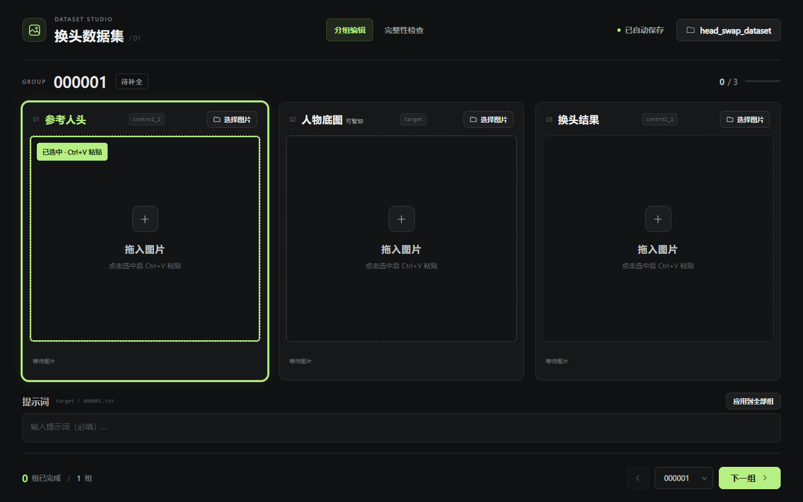
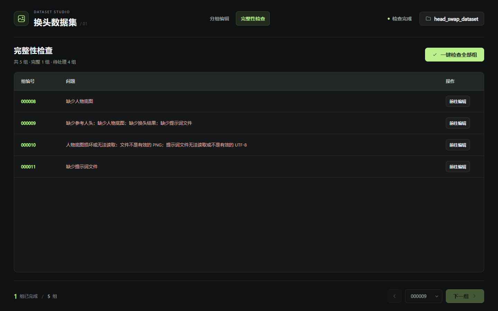

# HeadSwapDataTool · 换头数据集工具

一个用于制作换头训练数据集的本地网页工具。暗色极简界面，无需安装依赖，图片在本机处理和保存。



## 功能

- 三个图片输入区：参考人头、人物底图、换头结果，支持拖入、粘贴和文件选择。
- 参考人头、换头结果和提示词填写后即可进入下一组，人物底图可暂缺。
- 提示词必填，不接受空白内容；图片和提示词自动保存。
- 点击「应用到全部组」，确认后将当前有效提示词覆盖到所有现有组。
- 导航栏「完整性检查」可一键检查保存目录，表格列出缺图、损坏图片、缺少或为空的提示词，点击可跳转补齐。
- 图片底部显示像素尺寸、宽高比、PNG 文件大小和格式。
- 启动时检查保存文件夹的读写权限和实际写入能力，通过后才允许编辑。
- 图片按原尺寸转为 PNG，自动编号，支持载入已有数据集。

## 使用

1. 下载或克隆项目，用电脑端 **Edge 或 Chrome** 打开 `index.html`。
2. 按提示选择保存文件夹，完成路径校验。
3. 添加参考人头、换头结果并填写提示词，人物底图可稍后补充，点击「下一组」继续。
4. 在「完整性检查」中点击「一键检查全部组」，点击问题行或「前往编辑」补齐，再次检查确认。



点击图片区将其选中，醒目的加粗边框标记当前粘贴目标，再按 `Ctrl+V` 粘贴图片。文件选择使用每栏右上角的「选择图片 / 替换图片」按钮；放大查看使用底部「预览」按钮。关闭页面前，请等待顶部显示「已自动保存」。

## 保存结构

```text
head_swap_dataset/
├── target/             # 人物底图：原始真实照片
│   ├── 000001.png
│   └── 000001.txt      # 提示词，必填
├── control_1/          # 换头结果
│   └── 000001.png
└── control_2/          # 参考人头
    └── 000001.png
```

选择普通文件夹时会自动创建 `head_swap_dataset`，也可直接选择已有数据集目录。数据集文件不会提交到本仓库。

允许暂存未完成的组，但完整数据集要求三张有效 PNG 和非空 UTF-8 提示词。检查按保存目录中的文件进行，不判断图片人物是否匹配等视觉内容错误。页面保持固定，问题表格可在内部滚动。
